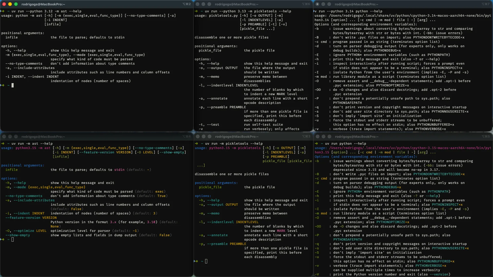

Learn about the top 3 developer experience improvements from Python 3.15

===

This article covers the top 3 improvements made to the developer experience of Python 3.15 users:

 1. improved error messages
 2. more colours
 3. default UTF-8 encoding

## 15 days of Python 3.15

To [celebrate the release of Python 3.15](/python-315), over the next 15 business days I'll be writing about a new 3.15 feature every day.
Explained clearly and with examples so you don't have to sift through the changelog.

Subscribe to receive this free email series:



If you want, you can also [check the schedule](/python-315) of the upcoming emails.

## Improved error messages

Over the past few years, lots of effort has been poured into improving Python's error messages.
Python 3.15 is no exception, as it introduces three improved types of error messages.

### Errors in accessing nested attributes

If you get an `AttributeError` exception when accessing a name of an object, but that object has another member that has the correct name, Python suggests it:

```py
class Inner:
    def __init__(self):
        self.value = 42

class Outer:
    def __init__(self):
        self.inner = Inner()

o = Outer()
o.value
# AttributeError: 'Outer' object has no attribute 'value'.
# Did you mean '.inner.value' instead of '.value'?
```

Incidentally, while Python 3.15 was in alpha, I [found and reported a bug with this feature](https://github.com/python/cpython/issues/146171) that was fixed in just a couple of hours!

### Checking methods from popular programming languages

If you get an `AttributeError` when trying to access a method from a built-in type, Python starts by checking if that's a typo.
For example, `list.pp` will ask if you meant to type `list.pop`.
Now, if there's no “obvious” typo, Python will also check a static table of common methods from other languages, like JavaScript, and suggest the Python equivalent.

For example, in JavaScript, you use `push` to add elements to a list:

```js
// JavaScript
my_list = [1, 2]
my_list.push(3)
console.log(my_list)  // [1, 2, 3]
```

In Python, if you try to use `.push` on a list, Python asks whether you meant to use `append`:

```py
# Python
my_list = [1, 2]
my_list.push(3)
# AttributeError: 'list' object has no attribute 'push'.
# Did you mean '.append'?
```

This looks especially neat when the Python equivalent is a syntactic feature, for example adding key/value pairs to dictionaries:

```py
d = {}
d.put(key, value)
# AttributeError: 'dict' object has no attribute 'put'.
# Use d[k] = v.
```

### Methods from mutable types used in immutable types

If you try to use a method of a mutable type in an immutable type, Python will ask whether you meant to use the mutable type in the first place:

```py
my_tuple = (1, 2)
my_tuple.append(3)
# AttributeError: 'tuple' object has no attribute 'append'.
# Did you mean to use a 'list' object?
```

As of Python 3.15, there are three pairs of mutable and immutable data types:

 1. `list` vs `tuple`
 2. `dict` vs `frozendict` ([learn more about `frozendict`](/blog/pydonts/frozendict-builtin), new in Python 3.15)
 3. `set` vs `frozenset` ([learn more about `set` and `frozenset`](/blog/pydonts/set-and-frozenset))

### Fixing typos when deletting attributes

When you try to delete an attribute and get an `AttributeError`, Python will check if the error arises from a likely typo:

```py
class MyClass:
    pass

obj = MyClass()
obj.bananas = 42
del obj.banaas
# AttributeError: 'MyClass' object has no attribute 'banaas'.
# Did you mean '.bananas' instead of '.banaas'?
```

### Correct usage of the terms “parameter” and “argument”

The terms “parameter” and “argument” are commonly used interchangeably but [they mean different things](/blog/pydonts/functions-a-complete-reference#parameters-versus-arguments).
In Python 3.15, more than 10 error messages were fixed to use the term “parameter” instead of “argument”.

Here's an example using a syntax error when defining a function:

```py
def foo(/, arg1):
    pass

# Python 3.15 error:
# SyntaxError: at least one parameter must precede /
```

In 3.14, the error reads “at least one _argument_ must precede /”.

### Historical record of improvements

The table below summarises the concerted effort that has been put into improving errors messages in Python over the past few years:

| Python version | Example of improvement | Learn more |
| :- | :- | :- |
| 3.10 | Syntax errors point to where a closing `)` or `}` is missing | [Link](https://docs.python.org/3/whatsnew/3.10.html#better-error-messages) |
| 3.11 | Tracebacks highlight the part of the line that raised the exception | [Link](https://docs.python.org/3/whatsnew/3.11.html#pep-657-fine-grained-error-locations-in-tracebacks) |
| 3.12 | Imports from modules with typos suggest the correct objects | [Link](https://docs.python.org/3/whatsnew/3.12.html#improved-error-messages) |
| 3.13 | Tracebacks are coloured | [Link](https://docs.python.org/3/whatsnew/3.13.html#whatsnew313-improved-error-messages) |
| 3.14 | Python suggests fixes to typos in keywords | [Link](https://docs.python.org/3/whatsnew/3.14.html#whatsnew314-improved-error-messages) |

## More colour in the terminal

Why is syntax highlighting a useful feature?
Because consistently colour-coding different entities (like keywords, built-ins, integers, strings, ...) makes it easier to parse the code you're reading.

In Python 3.13, with the changes to the Python REPL, folks started using more colour...
In Python 3.14, syntax highlighting was added to the REPL itself and to some of the CLIs from the standard library...
And Python 3.15 adds even more colour:



The image above shows the result of running `python --help`, and the modules `timeit`, `pickletools`, and `tokenize`.
The colour makes it easier to read the output of each tool.

Another thing to keep in mind is that the module `argparse` from the standard library, that allows creating CLIs, also supports colour.
This means that your own CLI's `--help` command can be coloured if it's built with `argparse`.

## UTF-8 is now the default file encoding

UTF-8 is now the default file encoding for all your calls to the built-in `open`.
This was already the case on Unix systems, but **not** for Windows users.

Suppose you write a file in a Unix machine:

```py
with open("python.txt", "w") as f:
    f.write("I like Python 🐍🚀!\n")
```

Then, you open your Windows machine and open the file to read:

```py
with open("python.txt", "r") as f:
    contents = f.read()
# UnicodeDecodeError: 'charmap' codec can't decode byte 0x90 in position 16: character maps to <undefined>
```

Except the code doesn't run, because you get an exception!
In Python 3.14 and earlier, using `open` in a Unix machine would be equivalent to using `open(..., encoding="utf8")`.
On the other hand, `open` on Windows would be equivalent to using `open(..., encoding="cp1252")`, which is not compatible with UTF-8.

From Python 3.15 onward, the default encoding is always UTF-8, which is the de facto standard used (almost) everywhere else.
This increases interoperability between OSes but also between Python and other tools.

## Python 3.15 brings much more to the table

From the two new built-ins `frozendict` and `sentinel`, to lazy imports, package startup configuration files, typing improvements, or more colour everywhere, Python 3.15 has a lot more to offer.
If you want to learn more about what's new in Python 3.15, [take a look at the “15 days of Python 3.15” series](/python-315) I'm running.
For 15 days, I'll explain a new Python 3.15 feature every day.

Get the free 3.15 email series:


