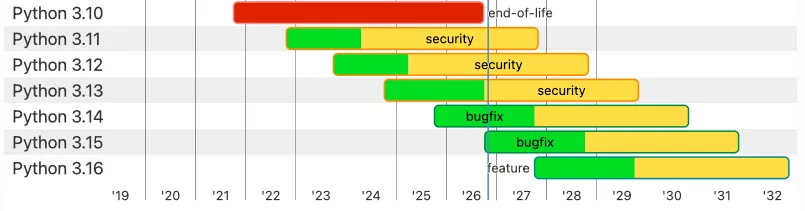

This practical guide tells you what to pay attention to when migrating to Python 3.15.

===

This short article walks you through the main things to keep in mind when migrating your code to Python 3.15:

 - **backwards-compatible features**: features released in 3.15 that you can start using because they're backwards compatible
 - **backwards-incompatible features**: features released in 3.15 that you can only start using if your project only targets Python 3.15+
 - **features that are now 100% supported**: features released in 3.11 that are now available in _all_ supported Python versions

## 15 days of Python 3.15

To [celebrate the release of Python 3.15](/python-315), over the next 15 business days I'll be writing about a new 3.15 feature every day.
Explained clearly and with examples so you don't have to sift through the changelog.

Subscribe to receive this free email series:



If you want, you can also [check the schedule](/python-315) of the upcoming emails.

## 3.15 migration guide

When a new Python version is released and you're considering adopting it, you need to think about three disjoint sets of features in the context of your project.
The first two are the set of new features that are backwards-compatible with other Python versions and the set of features that are _not_ backwards-compatible.
To understand the third set of features that's relevant, take a look at the following screenshot from python.org:



With the release of Python 3.15, Python 3.10 officially reached end-of-life and 3.13 entered the security-only stage.
This means that Python 3.10 won't be updated anymore and Python 3.13 won't be _improved_; it'll only receive security updates.
If you're working on projects that need to work across older Python versions, the end-of-life status of 3.10 means you can argue you only need to support 3.11 and newer.[^1]

[^1]: In practice, I'm sure there's someone somewhere _**still**_ using Python 2.7, even though that's been EOL for 6 years now... But let's not talk about _those_ people.

If a project goes from supporting Python 3.10+ to supporting 3.11+, this means that the project is now free to use whatever features were introduced in 3.11 and were not backwards compatible.
This is the third set of features to consider.

## Major new backwards-compatible features

Python 3.15 introduced [a lot of exciting new features](/blog/the-5-most-exiting-new-features-of-python-315), and there's a lot you can start using already even if you're going to support Python 3.11+ or 3.13+.

### Lazy imports

Python 3.15's [lazy imports](/blog/explicit-lazy-imports) introduce _new syntax_, which automatically means it's not backwards compatible.
However, [explicit lazy imports also introduced a backwards-compatible mechanism](/blog/explicit-lazy-imports#backwards-compatible-lazy-imports) using a global list `__lazy_modules__`:

```py
import math

__lazy_modules__ = ["math", "json"]

from json import dump, load
import pathlib
```

In Python 3.15+, the import of the module `json` is done lazily because it happens _after_ the module `json` is included in the list of modules to be loaded lazily.
In earlier Python versions, the list `__lazy_modules__` is just a regular Python list and if you don't use it for anything, the list is just ignored and all imports are eager.

### Typing improvements

Python 3.15 also [made some big changes to the typing front](/blog/typing-improvements-in-python-315), including [adding new behaviour to `TypedDict`](/typeddict-with-extra-items).

In most cases, type hints are only used at static type checking time, so there are always ways to use new typing features in older Python versions.
The most common way in which new typing features are usable in projects that support older Python projects is through [the module `typing_extensions`](https://github.com/python/typing_extensions).
When using `typing_extensions` is not an option, you can also write type hints as strings.
As long as you're using your static type checker with the most recent Python version, all should be fine.

### Better profiling

Python 3.15 introduced [a new sampling profiler called Tachyon](/blog/tachyon-sampling-profiling-in-python), and while Tachyon can only be used to profile programs running in the same Python version as Tachyon itself, that doesn't mean that a project supporting 3.11+ can't make use of Tachyon.

In practice, for scripts and other programs that run from start to finish, you can try running them directly with Tachyon.
The profiling information you get out of Tachyon will only be an approximation of the real numbers if you had to run your code with other Python versions, but it'll still provide insight into bottlenecks.

If your project provides long-running components, like web servers, you can also try running those directly with Python 3.15+ and then [using Tachyon to attach to the running process](/blog/tachyon-sampling-profiling-in-python#profiling-running-programs-with-attach-and-dump).

### abi3t

If your project publishes C extensions, you can start using [the new abi3t](/blog/python-abi3t-what-is-it) already.
The abi3t introduces a new limited C API that's compatible with free-threaded builds and using it means you'll be able to keep free-threaded-compatible wheels to a minimum as new Python versions come out.

### Considerations about the new built-in `frozendict`

The new built-in `frozendict` is _not_ backwards-compatible but there's something you should start working on to improve support for `frozendict` and users of Python 3.15+.
If your project _also_ supports 3.15+, [start defaulting to `collections.abc.Mapping` as the type hint for functions that work with dictionary-like objects](/blog/pydonts/frozendict-builtin#the-protocol-mapping) and using `collections.abc.MutableMapping` when the dictionary-like object must be mutable.
You should do this _even_ if your project also supports older Python versions.
That's because `dict` and `frozendict` have unrelated class hierarchies, so a function that expects a `dict` can't be called with a `frozendict`, although in many places that'd be ok.

## Backwards-incompatible features

Python 3.15 introduces a large number of backwards-incompatible features:

 - [built-in `frozendict`](/blog/pydonts/frozendict-builtin)
 - [built-in `sentinel`](/blog/pydonts/sentinel-builtin)
 - [lazy imports](/blog/explicit-lazy-imports) in their full generality
 - [thread-safe iterators](/blog/threadsafe-iterators)
 - [useful new tools in the standard library](/blog/4-upgrades-to-the-python-standard-library-in-315) in modules like `json`, `asyncio`, and more
 - the [new module `profiling`](/blog/module-profiling-overview) (that also holds the [new profiler Tachyon](/blog/tachyon-sampling-profiling-in-python))
 - [unpacking inside comprehensions](/blog/unpacking-inside-comprehensions)
 - [startup config files](/blog/startup-configuration-files)
 - and more...

The list of features above is far from exhaustive but covers the most notorious backwards-incompatible updates of Python 3.15.

### When to use the new features

If you're migrating a project to 3.15+, go through the list above to get acquainted with the new features that you have at your disposal.
Then, go through your code to look for opportunities to use these new features.

#### Lazy imports

If your code provides any runnable entry points, like CLIs or web servers, consider defaulting to using lazy imports.
Lazy imports speed up start up times essentially for free.

#### Built-in `frozendict`

When thinking about the pair `dict` vs `frozendict`, follow this rule:

 > The default is using `frozendict` and using `dict` means that you're signaling explicitly that the dictionary will have to be mutated.

_Don't_ think about it like this:

 > The default is using `dict` and using `frozendict` means that you're signaling explicitly that the dictionary can't change.

It's going to take some effort to fight years of muscle memory, but immutability by default is faster and safer, especially as we get closer to free-threaded Python.

The new built-in `frozendict` is especially useful when [paired with the new parameter `object_hook` in `json.load`](/blog/4-upgrades-to-the-python-standard-library-in-315#new-object-hook-in-json-load).
Together, they allow you to load JSON data as an immutable object.

#### Built-in `sentinel`

To use the new built-in `sentinel`, look for situations where you need to use a special default value (like `None` or `object`) in fairly generic situations where you migth receive any type of Python object.
Use cases for the new built-in `sentinel` also include scenarios in which you create a custom class to use as a singleton.

#### Thread-safe iterators

[Python 3.15 introduces tools to write and work with thread-safe iterators](/blog/threadsafe-iterators), so if you're writing threaded code, look for places where you could benefit from using plain Python iterators (patched up with the appropriate tools from Python 3.15).

## Major features that are now 100% supported

With the transition of Python 3.10 there's a number of major features introduced in 3.11 that are now supported by all active Python releases.

### Exception groups and `except*`

Python 3.11 introduced exception groups and the new syntax `except*`.
The new exception group syntax using `except*` was backwards-incompatible, but it's now safe to use it.

An exception group represents a group of unrelated exceptions that you want to raise and propagate together and the syntax `except*` can be used to match against parts of that exception group.
The snippet below demonstrates the functional behaviour of this feature:

```py
def inner():
    """Raises an exception group."""
    raise ExceptionGroup(
        "inner exception group",
        [ValueError(), TypeError()],
    )

try:
    inner()
except* KeyError:
    print("There was a KeyError inside the group")
except* ValueError
    print("There was a ValueError inside the group")

# There was a ValueError inside the group
```

### New module `tomllib`

Python 3.11 introduced the new module `tomllib` that adds TOML support to the standard library.
Now, you no longer need a third-party module to parse and read TOML files like the file `pyproject.toml` that holds Python project configuration.

### Typing improvements in 3.11

Although we just discussed above that most typing improvements can be used as soon as they come out, the fact that a typing improvement becomes supported by 100% of active Python versions make it more convenient to use.
With that in mind, Python 3.11 introduced a number of convenient typing improvements:

 - variadic generics and type variable tuples
 - the type `Self` for use inside classes
 - the type `LiteralString` for increased safety in some types of functions
 - items in `TypedDict` may be marked as required or not required

## What to do next?

As the next step, go look at your project.
If it's something you can play around with freely, upgrade to Python 3.15 and start playing around with the new Python 3.15 features.
If not, see if you can increase the lowest supported Python version to 3.11 or 3.13 and start looking for places where the “old new features” can be useful.
In either scenario, remember that there's new features in 3.15 that are backwards-compatible!

## Python 3.15 brings much more to the table

From the two new built-ins `frozendict` and `sentinel`, to lazy imports, package startup configuration files, typing improvements, or more colour everywhere, Python 3.15 has a lot more to offer.
If you want to learn more about what's new in Python 3.15, [take a look at the “15 days of Python 3.15” series](/python-315) I'm running.
For 15 days, I'll explain a new Python 3.15 feature every day.

Get the free 3.15 email series:


