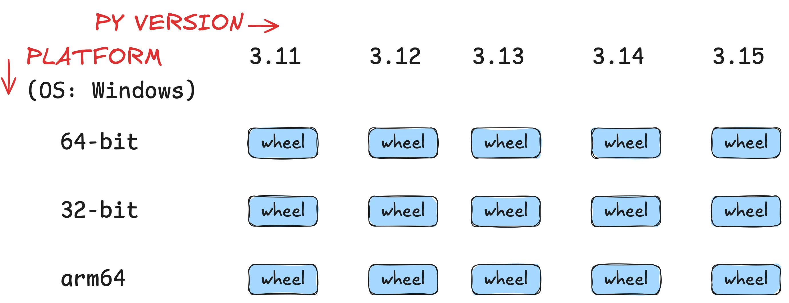
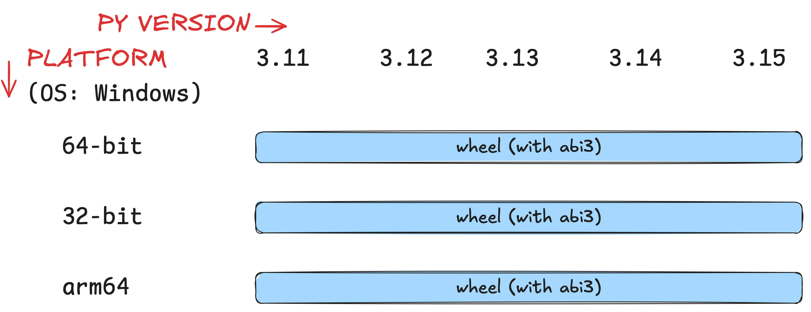
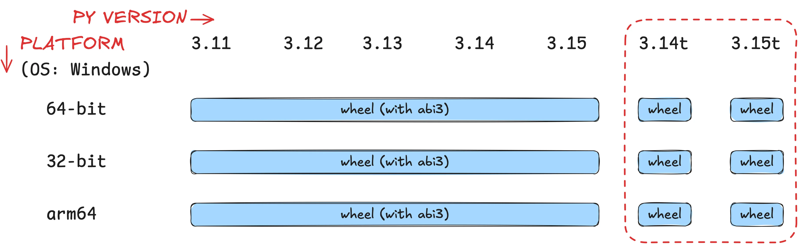
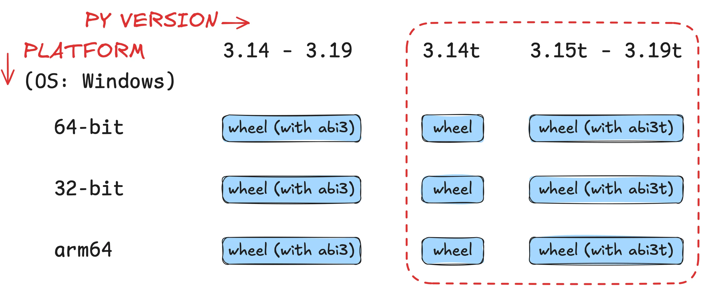

Learn what the abi3t and the limited C API are and what that means for Python users.

===

This article explains what the **limited C API** and the **abi3t** are to Python developers who don't have experience with C extensions.

## 15 days of Python 3.15

To [celebrate the release of Python 3.15](/python-315), over the next 15 business days I'll be writing about a new 3.15 feature every day.
Explained clearly and with examples so you don't have to sift through the changelog.

Subscribe to receive this free email series:



If you want, you can also [check the schedule](/python-315) of the upcoming emails.

## Python wheels

A **Python wheel** is the binary file that you download from PyPI every time you “pip install” a Python package.
Conversely, it's also the binary file you build when you're getting ready to publish your project to PyPI so that others can use it.

If you use uv to create a packageable project, cd into it, and then build it, you'll notice that uv builds a Python wheel for you:

```bash
% uv init --package pkgtest
Initialized project `pkgtest` at `~/pkgtest`
% cd pkgtest
~/pkgtest % uv build
Building source distribution...
Building wheel from source distribution...
Successfully built dist/pkgtest-0.1.0.tar.gz
Successfully built dist/pkgtest-0.1.0-py3-none-any.whl
```

The bottom line of output says that uv was successful in building the wheel `pkgtest-0.1.0-py3-none-any.whl`.

A Python wheel has the extension `.whl` and the three last segments of the file name are the compatibility tags: `{python tag}-{abi tag}-{platform tag}`.
These compatibility tags determine on what systems and environments the wheel can be installed:

| Compatibility tag | Meaning |
| :- | :- |
| Python tag | Python implementation and version required |
| ABI tag | What ABI is required, if any |
| Platform tag | The platform and architecture the distribution is compatible with |

In the example above, the compatibility tags were `py3-none-any`, which means

 1. the distribution `pkgtest` requires a Python 3 interpreter (`py3`)
 2. the distribution doesn't use any ABI (`none`)
 3. the distribution works on any platform and architecture (`any`)

The set of compatibility tags `py3-none-any` is the most common because it is the set of compatbility tags you get when you distribute a pure-Python package.
Things become more interesting when you're distributing packages with C extensions.

## The compatibility tags in Python C extensions

A C extension is a Python module that's written (partially) in C or C++.
A module might be written in C for a variety of reasons, including for performance reasons or because you want to interact with the internals of CPython.

When a module has a C extension, its compatibility tags become more relevant.

### Platform tags for C extensions

A C extension is a lower-level component when compared to a pure-Python file, since C code must be compiled for the platform and architecture it's going to run on.
That's what the platform tag is for.
A C extension that's compiled on 64-bit Windows will have a platform tag `win_amd64`, while an extension that's compiled on MacOS 11.0+ with an ARM processor will have the paltform tag `macosx_11_0_arm64`.

This means that a project must publish one wheel _for each platform and architecture_ they want to support.
NumPy, for example, supports 11 platform and architecture pairs across the macOS, Linux, and Windows operating systems.

### ABI tags for C extensions

When a new Python version comes out, we get a number of new Python features.
But the underlying C code also changes, so the C API of CPython also evolves with each Python version.
This means that a module with C extensions, that makes use of the C API of CPython, needs to keep up with the changes to the C API.
Whenever the C API changes, the maintainers need to update their C extensions, build them, and then publish the new updated versions.

The ABI tag is used to identify the version of the C API that the extension uses.
Since the C API extension is continuously evolving, this means that a project must publish one wheel _for each Python version that they support_ for each platform and architecture.

For example, NumPy supports Python 3.12 through 3.15, which is 4 different Python versions.
This means Numpy needs to publish 44 new wheels (4 Python versions times 11 platform/architecture pairs) each time a new NumPy version is released.

This is a huge burden and a lot of work, so the Python stable ABI was created.

## The stable ABI `abi3`

By taking a _limited_ set of functions from the Python C API, and ensuring they remain stable across Python releases, you can create a **limited C API** that C extension maintainers can use and that doesn't require updating the extensions when new Python versions are to be supported.

By adhering to the limited C API, an extension maintainer knows that if their extension works in Python 3.15 and uses the limited C API, their extension will also work _when_ Python 3.16 is released.
That's because they're using the _limited C API_, that remains stable across Python versions.
In doing so, a maintainer is no longer required to use different C APIs for each Python version supported and it cuts down the number of wheels that need to be built.

If you get to use a single API for all Python versions, the number of wheels required goes down by a factor equal to the number of Python versions you support.
If your extension supports Python 3.11 through 3.15, that's 5 Python versions.
Before, you needed a wheel per Python version and platform:



With the stable API, you only need 3 wheels:



The ABI tag for the stable ABI is `abi3`.
And `abi3` makes things easier, but then Python started experimenting with a free-threaded build...

## Free-threaded Python and `abi3t`

Free-threaded Python introduced another variable when it comes to building C extensions.
If you're just looking at Windows, that's 6 new wheels to support free-threaded Python:



That's because the class stable ABI `abi3` does not support free-threaded Python.

For now, it's _only_ 6 new wheels because there's only two versions of free-threaded Python to support.
But as new Python versions are released, the number of wheels will keep multiplying.
So, Python 3.15 introduced `abi3t`, a **stable ABI for free-threaded builds**.

The new stable ABI for free-threaded Python was only introduced in 3.15, so it won't be compatible with 3.14.
But in a couple of years, when the supported Python versions are 3.14 through 3.19, the wheels required will be 3 for non-free-threaded Python, 3 for Python 3.14t that's not covered by the new `abi3t`, and 3 more for free-threaded Python 3.15 through 3.19:



If you didn't introduce `abi3t`, you'd need 15 wheels just for the free-threaded builds of Python.

## Conclusion

In short, the addition of the `abi3t` stable ABI for free-threaded Python builds reduces the maintenance burden of Python packages that have C extensions.
On the one hand, it reduces the number of build artifacts that need to be built, tested, distributed, and hosted.
On the other hand, it also means that C extensions are automatically compatible with new Python versions as they come out.

## Python 3.15 brings much more to the table

From the two new built-ins `frozendict` and `sentinel`, to lazy imports, package startup configuration files, typing improvements, or more colour everywhere, Python 3.15 has a lot more to offer.
If you want to learn more about what's new in Python 3.15, [take a look at the “15 days of Python 3.15” series](/python-315) I'm running.
For 15 days, I'll explain a new Python 3.15 feature every day.

Get the free 3.15 email series:



