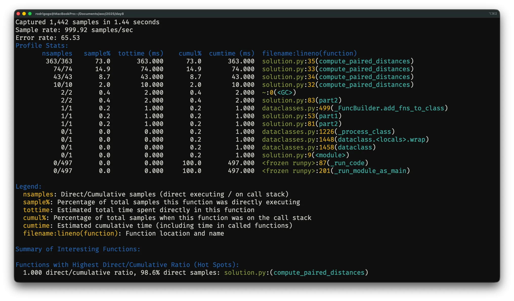

Learn how to use Tachyon, Python's sampling profiler.

===

“Tachyon” is a new sampling profiler that was introduced in Python 3.15.
It provides a CLI that allows running and profiling scripts or attaching to running processes.


In this article you'll learn what statistical profiling is and how to use the Tachyon CLI to identify performance bottlenecks in your code.

## 15 days of Python 3.15

To [celebrate the release of Python 3.15](/python-315), over the next 15 business days I'll be writing about a new 3.15 feature every day.
Explained clearly and with examples so you don't have to sift through the changelog.

Subscribe to receive this free email series:



If you want, you can also [check the schedule](/python-315) of the upcoming emails.

## What is statistical profiling

**Statistical profiling** is the practice of profiling your code by periodically taking snapshots of the state of your Python program.
Since you're _periodically_ snapshotting the call stack of your program, you call Tachyon a **sampling profiler**.

Tachyon collects all of its samples over a profiling run and uses it to estimate how much time is being spent in each part of your code.
Suppose Tachyon collects 1,000,000 samples over the course of 10 seconds.
Out of those 1,000,000 samples, assume 25,000 samples (2.5%) show the function `foobar`.
Tachyon _estimates_ that you spent 2.5% of the 10 seconds, or 250 miliseconds, inside the function `foobar`.

The longer Tachyon runs, and the higher its frequency (the shorter the interval between snapshots), the more accurate the results that Tachyon produces.

## Using the Tachyon CLI

Tachyon is the “cool” name for the module `profiling.sampling` from the standard library.
Since it's a module from the standard library, you can use it with the switch `-m profiling.sampling`:

```bash
% python -m profiling.sampling --help
usage: python -m profiling.sampling [-h] {run,attach,dump,replay} ...

Sample a process's stack frames and generate profiling data.

Examples: ...

Use python -m profiling.sampling <command> --help for command-specific help.

positional arguments:
  {run,attach,dump,replay}
                        Command to run
    run                 Run and profile a script or module
    attach              Attach to and profile a running process
    dump                Dump a running process's current stack
    replay              Replay a binary profile and convert to another format

options:
  -h, --help            show this help message and exit
```

Alternatively, you can use it as `uv run -m profiling.sampling ...` if you're using uv.

The output above shows that Tachyon has four main commands: `run`, `attach`, `dump`, and `replay`.

## Using Tachyon to run a script

The Tachyon command `run` can be used to run a Python script and profile it from start to finish:

```bash
% python -m profiling.sampling run myscript.py
```

The command above runs the script `myscript.py` and presents profiling information in the terminal when the script is over.
The output may look something like this:



## Output formats

Tachyon can also produce output in various different formats.
Below you'll learn to use Tachyon to produce line-by-line heatmaps and flamegraphs.

### Line-by-line heatmap

The option `--heatmap` produces a heatmap:

```bash
% python -m profiling.sampling run --heatmap myscript.py
...
Heatmap output written to heatmap_30282/
  - Index: heatmap_30282/index.html
  - 1 source file analyzed
```

The output is a folder with an `index.html` file that you can open and use to navigate to any of the source files of the program you just profiled.
Once you open a file, it may look similar to the screenshot shown below:


The heatmap a lot of line-specific information, but the most immediate thing is that it highlights the “hot” lines, which are the lines that Tachyon estimates are taking the most time.

### Flamegraph

Tachyon can also be used to produce a flamegraph if you enable the option `--flamegraph`:

```bash
% python -m profiling.sampling run --flamegraph myscript.py
...
Flamegraph data: 1 root function, 71388 total samples, 51 unique strings
Flamegraph saved to: flamegraph_30335.html
```

The option `--flamegraph` produces an HTML file that you can open to see a flamegraph like the one from the screenshot below:


The flamegraph shown above only has three levels, which shows that the program that was profiled wasn't very complex.
In this flamegraph, the length of a bar is proportional to the time the program spent on the corresponding line of code.

## Profiling running programs with `attach` and `dump`

The Tachyon command `dump` can be used to get a dump of the call stack from a running Python program.
All you have to do is find the process ID of the running Python program and then run

```bash
% python -m profiling.sampling dump 12345
```

The command above assumes the process ID was `12345` and would produce output that could look like this:


The command `dump` takes a single screenshot of the running process.
You can also use the command `attach` to start profiling a running Python process.

Since Tachyon is a sampling profiler, Tachyon can profile a running process with virtually zero overhead, making it ideal to profile production systems, for example.

The command `attach` also accepts the process ID, just like `dump`:

```bash
% python -m profiling.sampling attach 12345
```

When it attaches, Tachyon will default to profiling until the process it attached to terminates.
You can attach for only a specific duration by specifying the flag `--duration SECONDS`.
Alternatively, you can use the flag `--live` to see live results:


The command `attach` can also produce output in the many formats that `run` supports, of which a heatmap and a flamegraph are just two examples.

## The command `replay`

The Tachyon command `replay` allows you to convert profiling data stored in the binary format into another format supported by Tachyon.
You can produce binary data by using the flag `--binary`.
To produce binary data, you'll first want to run something like

```bash
% python -m profiling.sampling run --binary -o profile.bin myscript.py
```

The option `--binary` specifies the binary output and the option `-o profile.bin` sets the output file name to `profile.bin`.
(The option `-o` can be used with the other output formats as well.)

Then, once you have the binary data, you can use the command `replay` to convert it.
For example, the command `replay` with no other options produces the default Tachyon output:

```bash
% python -m profiling.sampling replay profile.bin
# Prints the pstats format to stdout.
```

To produce output in other formats, you use the respective options.
For example, the command below replays `profile.bin` to turn it into a flamegraph:

```bash
% python -m profiling.sampling replay --flamegraph -o my_flamegraph profile.bin
```

This command creates a flamegraph called `my_flamegraph`.

The benefit of producing binary data and then using the command `replay` is that you can profile your code just once and then perform multiple analyses.

## When not to use Tachyon

The documentation for Tachyon includes a very clear description of situations in which Tachyon shouldn't be used:

 - **measuring short running times**: if you're trying to profile a program that finishes quickly you should either use tracing profiling or you should run your program in a loop
 - **micro-benchmarks**: if you're trying to measure a micro-benchmark (think a short expression that is _very_ fast), you should use `timeit`
 - **small performance differences**: if you're trying to measure small performance differences (think 1%–2%), for example between two implementations of the same algorithm, Tachyon may not be able to pick those up; instead, use tracing profiling for precise measurements
 - **exact call counts**: if you need the exact call count for the functions in your code, you need something that provides _exact_ results like tracing profiling

## Python 3.15 brings much more to the table

From the two new built-ins `frozendict` and `sentinel`, to lazy imports, package startup configuration files, typing improvements, or more colour everywhere, Python 3.15 has a lot more to offer.
If you want to learn more about what's new in Python 3.15, [take a look at the “15 days of Python 3.15” series](/python-315) I'm running.
For 15 days, I'll explain a new Python 3.15 feature every day.

Get the free 3.15 email series:


