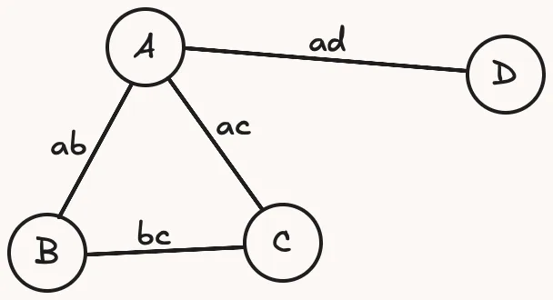

# 🐍🚀 dark computer science “translation”

 > This is a past issue of the [mathspp insider 🐍🚀](/insider) newsletter.
 > [Subscribe to the mathspp insider 🐍🚀](/insider) to get weekly Python deep dives like this one on your inbox!


## P versus NP..?

During the final day of the [Algorithm Mastery Bootcamp](/courses/algorithm-mastery-bootcamp) I had a conversation with one of the participants about a very fascinating but weird mathematical problem that is deeply tied with computer science: the **P versus NP** problem.

(By the way, the bootcamp ended last week but I’m running a slow-paced cohort, during 12 weeks, in January. Keep your eyes peeled for the announcement email during this week.)

Simplifying things A LOT, to the point where the maths police might strip me of my title if they read this, the P versus NP problem asks:

> Are there problems that are inherently difficult or is it the case that we, Humans, haven’t been clever enough to figure out efficient algorithms for the ones that look difficult?

Now, what the heck does it mean for a problem to be “difficult”?

I’ll give you an example.

## The SAT problem

And no, I’m not talking about those pesky tests you take if you’re in the US.

The SAT problem, short for SATisfiability problem, is the problem of determining whether a given Boolean formula can be satisfied by a given set of assignments.

For example, the formula `A OR B` is satisfiable: for example, set `A = True` and there you go.

As another example, the formula `A AND NOT A` is unsatisfiable: there is no way to make the formula evaluate to True.

The SAT problem is “difficult“ (in the P versus NP sense) because we don’t have an efficient algorithm that solves the problem for an arbitrary formula.

In the general case, all we can do is run through **all possible permutations** of values for the variables and pray that we find an answer soon enough.

(This brute-force algorithm is exponential in the number of variables:

 - for 2 variables, there’s 4 possible assignments
 - for 20 variables, there’s 1,048,576 possible assignments
 - for 200 variables, there’s _only_ 1,606,938,044,258,990,275,541,962,092,341,162,602,522,202,993,782,792,835,301,376 possible assignments.)

So, “P vs NP” asks: is there an efficient algorithm to solve this problem and we haven’t discovered it yet, or is it **impossible** to come up with such an algorithm?

But things get better.

## SAT is NP-complete

The SAT problem is so cool that, not only is it “hard” (hence, NP), but can also be used to express every other hard problem.

In other words, any other hard problem can be **translated** into a corresponding SAT problem.

Because of this, we say that SAT is “NP-complete”.

But what the heck does it mean to _translate a problem into SAT_?

That’s what I’m going to show now.

## Graph 3-coloring

Take a look at the graph below:



Can you paint the nodes A, B, C, and D, with **three colours only** (red, green, blue), such that no two nodes that are connected share the same colour?

For example, you couldn’t paint A and D both in red because they’re connected, but one could be red and the other could be blue.

It is easy to solve this particular instance of this problem, but in general this problem is also an NP problem.

So, if it is an NP problem, it means you can translate it into SAT!

Here’s how.

## Translating graph coloring into SAT

Start by creating three variables per node, each one referring to a particular colour:

```py
Var("A_red"), Var("A_green"), Var("A_blue")
Var("B_red"), Var("B_green"), Var("B_blue")
Var("C_red"), Var("C_green"), Var("C_blue")
Var("D_red"), Var("D_green"), Var("D_blue")
```

The idea is that each variable tells you whether a given colour is being used for a given node.

For example, if `Var("A_red")` is `True`, then you’re painting the node A in red.

But wait, what if `Var("A_blue")` is also `True`?!

You can’t have two colours on the same node…

You are right, and that is why you need to write **_formulas_** with your variables.

To create these restrictions in SAT-land.

That’s what you’ll do now:

## Each node must have at least one colour

Each node needs to have at least one colour.

How do you specify that with these variables?

You can use an OR:

```py
# A has to be red or green or blue:
Or(Var("A_red"), Var("A_green"), Var("A_blue"))
```

This Boolean expression is `True` only if there is at least one colour assigned to the node A.

This is a great start but doesn’t solve our issue yet.

What if `Var("A_red")` and `Var("A_blue")` are both set to `True`..?

## No node can have two colours

Well, that’s easy!

Just say that node A can’t have the colours red and blue:

```py
Not(
    And(Var("A_red"), Var("A_blue"))
)
```

But do that for all combinations of colours:

```py
And(
    # A can't be both red and blue:
    Not(And(Var("A_red"), Var("A_blue"))),
    # A can't be both blue and green:
    Not(And(Var("A_blue"), Var("A_green"))),
    # A can't be both green and red:
    Not(And(Var("A_green"), Var("A_red"))),
)
```

This is looking pretty good!

I mean, the formulas look nasty because you have to do all of this _for each node_...

But the “translation” is going quite well!

You just have one restriction left:

Adjacent nodes can’t have the same colour!

How would you encode that as a Boolean formula..?

## Adjacent (connected) nodes can’t have the same colour

Well, A and B can’t have the same colour, which means:

 - A and B can’t both be red
 - A and B can’t both be green
 - A and B can’t both be blue

Here’s how to write this as a formula:

```py
And(
    # A and B can't both be red:
    Not(And(Var("A_red"), Var("B_red"))),
    # A and B can't both be blue:
    Not(And(Var("A_blue"), Var("B_blue"))),
    # A and B can't both be green:
    Not(And(Var("A_green"), Var("B_green"))),
)
```

You do this for each edge (connection) and voilà, you got yourself a SAT problem!

## Now it’s your turn: write the SAT solver

Next week I’ll be back with a SAT solver: some nice Python code to solve this problem.

Until then, take a look at the code from this issue and try to write a function `solve` that accepts all of these formulas and finds Boolean values to assign to the four variables so that the formulas are all SATisfied.

(You’ll also need to implement `Var`, `Not`, `And`, and `Or`.)

Email me your code when you’re done!

## Enjoyed reading? 🐍🚀

Get a _free_ Python deep dive 🐍🚀 every Monday by dropping your best email address below:


