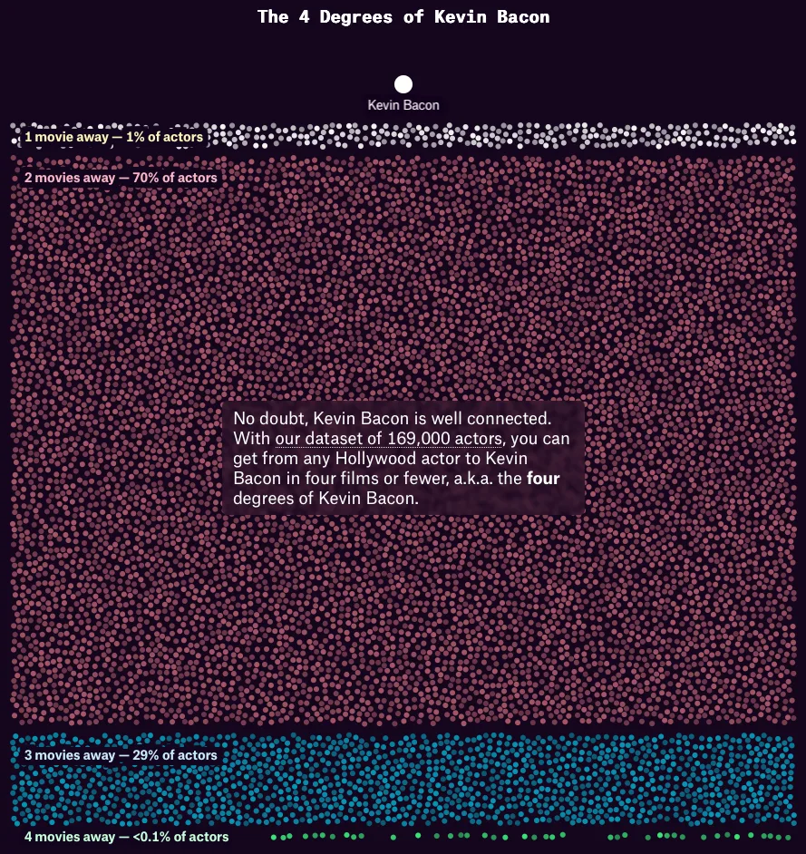

This “The Pudding” essay studies “the six degrees of Kevin Bacon”, a Hollywood version of [the Erdős number](https://en.wikipedia.org/wiki/Erdős_number) from maths.
The author Owen Lacey took a dataset of 169,000 actors and concluded that Kevin Bacon was 4 movies away from _any_ Hollywood actor:

The author also verified that _no_ Hollywood actor was only 3 movies away from all of Hollywood, despite some actors being only 3 movies away from the vast majority of actors.
For example, Kevin Bacon is 4 movies away of less than 0.1% of Hollywood actors.

Then, the author computed the remoteness of each actor: the average degree of separation for all other actors.
Using data from March 2026, the top 5 of smallest remoteness levels follows:

| Rank | Actor | Remoteness |
| :- | :- | :- |
| 1. | Samuel L. Jackson | 2.09 |
| 2. | Willem Dafoe | 2.13 |
| 3. | Robert De Niro | 2.14 |
| 4. | Morgan Freeman | 2.14 |
| 5. | Bruce Willis | 2.14 |
